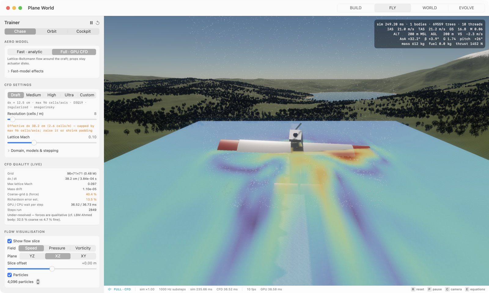
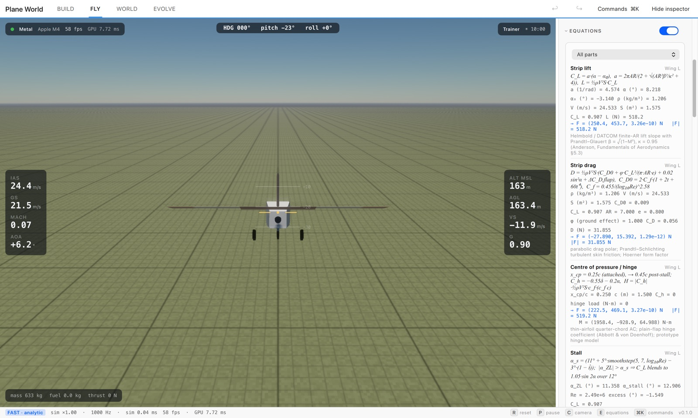

# Plane World

A flight and vehicle physics sandbox: build crafts from parts or CAD, fly them over procedural or real terrain, and
evolve controllers and designs. Three kinds of aero, kept distinct:
- **Fast (analytic):** strip-theory wings, momentum props and actuator-disk slipstream. Runs far above real time.
- **CFD · Lattice Boltzmann:** real-time GPU CFD around the craft.
- **CFD · Navier–Stokes FV:** a GPU finite-volume solver (URANS k-ω SST, multigrid). Slower, and closer to
  wind-tunnel numbers.

An offline **OpenFOAM reference** export is provided for checking all three.
C++20 core, Qt 6 Quick UI, Metal and Direct3D 12 renderers with shaders written once in Slang.

| BUILD | FLY |
|---|---|
|  |  |
| **WORLD** | **EVOLVE** |
|  |  |
| **FLY, Full CFD with a speed slice** | **FLY, live EQUATIONS** |
|  |  |

- **BUILD:** parts (wings, servos, props, motors, jets, solids, tanks, wheels, sensors, primitives), CAD import
  (STL / OBJ / glTF / GLB; USD / USDZ on macOS) with auto-rig, mesh cut, outputs with key bindings, undo / redo.
- **FLY:** 1 kHz physics, chase / orbit / cockpit cameras, per-output sliders, HUD, aero model picker, CFD settings
  and diagnostics, flow slice overlay, and the EQUATIONS panel (every fast-model equation with live values).
- **WORLD:** flat, procedural (GPU erosion), heightmap or real-world terrain; sculpt and paint; ocean, lakes, rivers,
  vegetation, props and breakables; sky and wind. New → *Manhattan (Midtown)* builds a detailed, flyable Midtown.
- **EVOLVE:** GA, CMA-ES, sep-CMA-ES, OpenAI-ES, NEAT, MAP-Elites, novelty search or your own algorithm in JavaScript;
  neural controllers, craft designs or both; headless parallel training, charts, replays in the viewport.

## Using the app

The four tabs form one loop: **BUILD** a craft → shape the **WORLD** it flies in → **FLY** it there → **EVOLVE** a
controller or design, then fly the result.

- FLY always flies the craft open in BUILD, in the world open in WORLD: terrain, trees and props collide, and the
  world's wind blows. The chip at the top right of FLY names the world (click it to edit); the inspector's *World*
  card switches to flat ground for testing a design.
- WORLD edits are live, no export step. *Fly here* (`Ctrl+Shift+2`) starts a flight at the centre of the view,
  facing the way the camera looks; *Fly from spawn* uses the spawn point (spawn tool, key `O`). Save keeps a world for
  later sessions.
- EVOLVE is laid out as steps: **Set up** (① craft & world, ② what evolves, ③ goal picked in plain words —
  hold altitude, hover, fly to a target, max distance, drive to a point — or your own script, ④ algorithm) and
  **Train** (⑤ Start training with live generation / best score / time left, ⑥ fly the best with its evolved
  autopilot, replay it or save it as a craft). The default *Quick start* learns to hold altitude in about ten seconds.
- `Ctrl+1`…`4` switch tabs, `Ctrl+K` searches every action, and the welcome tour is in Settings (`Ctrl+,`).

## Platforms

| OS | GPU API | Tested on |
|---|---|---|
| macOS 14+ (Apple silicon) | Metal | Apple M4; CI on macOS 15 arm64 |
| Windows 10 / 11 x64 | Direct3D 12 (WARP software fallback) | CI on `windows-latest` (WARP) |

Any Direct3D 12 GPU (feature level 11_0+; NVIDIA, AMD, Intel) or Apple silicon GPU. Per-vendor tuning lives in `pwgpu`.

## Build and run

Requirements: CMake 3.24+, Ninja, Qt 6.8, and the [Slang](https://github.com/shader-slang/slang/releases) release
unpacked to `~/.local/slang-<version>` or pointed at by `SLANG_DIR`.

**macOS** (Command Line Tools are enough):

```sh
brew install cmake ninja qt
cmake -S . -B build -G Ninja -DCMAKE_PREFIX_PATH=/opt/homebrew/opt/qt && cmake --build build
open "build/src/app/Plane World.app"
```

**Windows** (Visual Studio 2022 C++ workload, Qt 6.8 MSVC 2022 64-bit), from an "x64 Native Tools" prompt:

```bat
cmake -S . -B build -G Ninja -DCMAKE_PREFIX_PATH=C:/Qt/6.8.3/msvc2022_64 -DSLANG_DIR=C:/slang
cmake --build build
cmake --build build --target pwapp_deploy
build\deploy\"Plane World.exe"
```

Tests:

```sh
build/tests/pwtests                                       # unit, parity, GPU and renderer tests
QT_QPA_PLATFORM=offscreen build/src/app/pwuitests         # WORLD / EVOLVE view models
build/src/cli/pwcli --selftest all                        # self-test registry (--selftest list)
```

Installers: `packaging/macos/make_dmg.sh build` and `packaging/windows/make_msi.sh build`
([docs/PACKAGING.md](docs/PACKAGING.md)). CI (`.github/workflows/ci.yml`) builds, tests and packages both platforms
on every push to `main`; a `v*` tag drafts a GitHub release.

## Command line

```sh
pwcli --train examples/experiments/hover-pid.json --generations 10 --out /tmp/hover   # headless training, all cores
pwcli --train my.json --resume --out /tmp/hover            # continue from the checkpoint in --out
pwcli --make-experiment "Neural controller" my.json        # preset -> editable experiment
pwcli --aero-compare Trainer --speed 25 --alpha 4          # fast model vs CFD (LBM), per part
pwcli --aero-compare Trainer --speed 25 --alpha 4 --ns     # + Navier–Stokes FV column (--openfoam <case> adds OpenFOAM)
pwcli --openfoam-export Trainer --speed 25 --alpha 4 --out cases/t25   # OpenFOAM reference case (--run if installed)
pwcli --bench all                                          # benchmarks (--bench list)
pwcli --info                                               # CPU features, GPU backend
```

`--train` also takes `--workers`, `--population`, `--seed`, `--aero fast|full`, `--cfd-preset`, `--script-engine`.
The app takes `--tab`, `--color-scheme`, `--size WxH`, `--command "<palette entry>"` (or `"wait <s>"`, run in order) and
`--screenshot out.png --quit-after <s>` (how the screenshots above were made).

## Docs

| File | Contents |
|---|---|
| [ARCHITECTURE.md](docs/ARCHITECTURE.md) | Targets, threading, determinism, GPU backends and shaders, tests |
| [PHYSICS.md](docs/PHYSICS.md) | Every fast-model equation with code location, validity and sources ([interactive explainer](docs/explainer.html)) |
| [CFD.md](docs/CFD.md) | Lattice-Boltzmann method, settings, presets, diagnostics, training with CFD |
| [CFD_NS.md](docs/CFD_NS.md) | Navier–Stokes finite-volume CFD (URANS k-ω SST), validation, LBM vs NS vs OpenFOAM, OpenFOAM reference |
| [EVOLUTION.md](docs/EVOLUTION.md) | EVOLVE, experiment format, JavaScript API, algorithms, reward shaping |
| [SCRIPTING.md](docs/SCRIPTING.md) | JavaScript engines (JavaScriptCore, QuickJS) and their differences |
| [CRAFTS.md](docs/CRAFTS.md) | Bundled crafts and the ducted-rocket design |
| [WORLDS.md](docs/WORLDS.md) | World presets (incl. Manhattan), prop params (shape / colour / facade pattern / collide) |
| [CONTROLS.md](docs/CONTROLS.md) | Keys → axes → controller → outputs: mix tables, the multirotor flight controller, adding a controller |
| [PERF.md](docs/PERF.md) | Benchmarks and methodology |
| [PACKAGING.md](docs/PACKAGING.md) | .dmg / .msi, signing, CI release |
